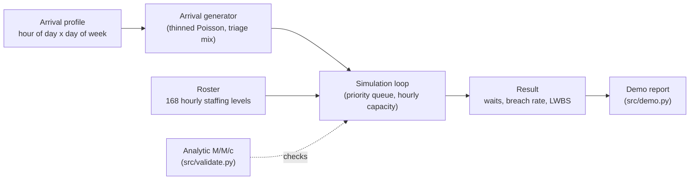

# surgecapacity

An emergency department staffing model that reports p95 wait and breach probability, because staffing to the mean guarantees failure.

[](https://github.com/nehakongari60-a11y/surgecapacity/actions/workflows/ci.yml)

## Why

An emergency department staffed to average demand is understaffed roughly half the time. Queues are non-linear, so that half produces almost all of the very long waits, ambulance diverts and patients who leave without being seen. A spreadsheet that divides annual patients by annual hours gives a number that is right on average and wrong every evening. This project simulates the department hour by hour and reports the tail (p95, p99, breach probability) instead of the mean.

## Features

- Discrete-event, priority-queue simulation of an ED with five triage categories (resus to non-urgent), each with its own share and service-time distribution.
- Non-homogeneous Poisson arrivals shaped by an hour-of-day and day-of-week profile, generated by thinning, plus a surge multiplier for scenarios such as a flu peak.
- Hourly staffing rosters covering all 168 hours of the week, with helpers for flat, demand-shaped and "move N clinicians between hours" rosters (cost-neutral by construction).
- Reporting of mean, p50, p95, p99, four-hour breach rate and left-without-being-seen rate, plus waits by triage category and by hour of the week.
- Reproducible runs: a fixed seed gives identical results.
- An analytic M/M/c module (Erlang C, mean wait, exact wait quantiles) used to validate the simulator against closed-form results.
- Standard library only; nothing to install.

## Architecture



`src/sim.py` generates a week-periodic arrival stream, then runs patients through a priority queue (lower triage number first, ties by arrival time) served by however many clinicians the roster has on duty in that hour. Lower-acuity patients who have waited six hours leave without being seen. `src/validate.py` provides the closed-form M/M/c results the tests compare the simulator against.

## Quick start

Requires Python 3.11 or newer. There are no dependencies.

```bash
git clone https://github.com/nehakongari60-a11y/surgecapacity.git
cd surgecapacity
python -m unittest discover -s tests -v   # run the test suite
python -m src.demo                        # run the roster comparison
```

## Usage

```python
from src.sim import flat_roster, demand_shaped_roster, simulate

flat = flat_roster(9)                                  # 9 clinicians, every hour
shaped = demand_shaped_roster(flat.total_hours)        # same hours, shaped to demand

a = simulate(flat, weeks=12, arrivals_per_hour_mean=7.0, seed=17)
b = simulate(shaped, weeks=12, arrivals_per_hour_mean=7.0, seed=17)
print(a.percentile(95), b.percentile(95), a.breach_rate, b.breach_rate)
```

`python -m src.demo` prints (trimmed):

```text
  First, the simulator is validated against closed-form M/M/c:
    utilisation 80%   mean wait 0.52h   p95 wait 2.34h
    the p95 is 4.5x the mean - that ratio is the entire problem.

  roster                        mean     p50     p95     p99    breach     LWBS
  flat (staffed to mean)        0.79    0.09    4.42    5.54      6.4%     4.7%
  demand-shaped                 0.31    0.00    2.05    5.18      2.2%     2.4%
  flat, 2 moved Tue3am->Sat8pm  0.78    0.09    4.34    5.53      6.2%     4.6%

  A 25% surge (flu peak) against the flat roster:
    mean wait 0.79h -> 1.33h (+33 min)
    p95 wait  4.42h -> 5.47h (+63 min)
    breach    6.4% -> 14.9%
```

All three rosters use the same 1,512 clinician-hours per week. Reshaping the rota to follow demand cuts the mean wait by 28 minutes but the p95 wait by 142 minutes.

## How it works

- **Arrivals.** Candidate arrivals are drawn at the peak rate and accepted with probability proportional to the current hour's intensity, which yields a non-homogeneous Poisson process without a flat-rate assumption.
- **Service.** Service times are exponential with a per-category mean (2.5 h for resus down to 0.45 h for non-urgent).
- **Capacity.** Capacity changes hourly, so the loop tracks completion times in a heap and compares them to the roster's on-duty count at the current time, also advancing to each hour boundary.
- **Why the tail.** For M/M/c, `P(W > t) = C * exp(-(c*mu - lambda) * t)`, so the quantile is exact. In the demo case the p95 is 4.5 times the mean, which is why mean-based staffing hides the problem.
- **Validation.** Tests run the simulator in an M/M/c configuration (flat arrivals, one class, no balking) and compare mean wait and the p50, p90 and p95 wait quantiles to the analytic values.

## Testing

```bash
python -m unittest discover -s tests -v
```

The 16 tests cover agreement with closed-form M/M/c (mean and tail), Erlang C at known points, hour-of-week arrival intensity, worse waits at peak hours, cost-neutral roster changes, ordered percentiles, consistency of the breach rate, triage priority being honoured, reproducibility under a fixed seed, and the larger tail impact of a surge.

## Project layout

```
src/
  sim.py        simulation, rosters, arrival profile, results
  validate.py   analytic M/M/c (Erlang C, mean and quantiles)
  demo.py       roster comparison and surge report
tests/
  test_sim.py
docs/
  ARCHITECTURE.md
```

## Limitations

- The arrival profile and triage mix are illustrative, shaped like published A&E attendance curves, not fitted to a real dataset.
- Service times are exponential; real ED service times are heavier-tailed.
- Single resource pool (clinicians); beds, imaging and bottleneck attribution are not modelled.
- It sizes a staffing requirement; it does not build a rota or forecast demand.
- Results come from a single seeded run per scenario, without replication or confidence intervals.

## License

MIT, see [LICENSE](LICENSE).

## Maintainer

Neha Kongari maintains this project, applying a data-analytics perspective to simulation and model validation. For questions or suggestions, contact [nehakongari60@gmail.com](mailto:nehakongari60@gmail.com).