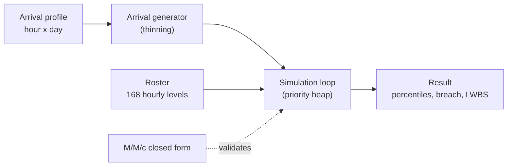

# Architecture

## Context

Emergency departments are commonly staffed to average demand. Because waiting time grows non-linearly with utilisation, the periods where demand exceeds the average dominate long waits and walk-outs. surgecapacity simulates a week-periodic department and reports tail metrics so staffing can be compared on the outcomes that targets are written against.

## Container view

## Key decisions

- **Report the tail, not the mean.** The result object exposes p50/p95/p99, breach rate and left-without-being-seen rate. Trade-off: percentiles from one run are noisy, so comparisons use the same seed across scenarios.
- **Hour-of-week arrivals.** Intensity is the product of an hour-of-day and a day-of-week profile, sampled by thinning. Trade-off: the profile is illustrative rather than fitted.
- **Cost-neutral comparisons.** `Roster.moved` and `demand_shaped_roster` keep total staffed hours fixed, so differences come from scheduling rather than budget.
- **Validate before trusting.** `src/validate.py` gives exact M/M/c mean and quantiles; the tests run the simulator in that configuration first.
- **Standard library only.** No install step, deterministic via `random.Random(seed)`.

## Failure modes

- A roster with zero clinicians in an hour only stalls the queue until the next hour boundary; the loop advances to hour boundaries so it cannot hang.
- A roster of the wrong length is rejected with `ValueError`.
- Utilisation at or above 1 in the analytic module returns a wait probability of 1 rather than a misleading finite value.

## Out of scope

Rota generation, demand forecasting, multiple resource pools (beds, imaging), non-exponential service times and replication statistics.
